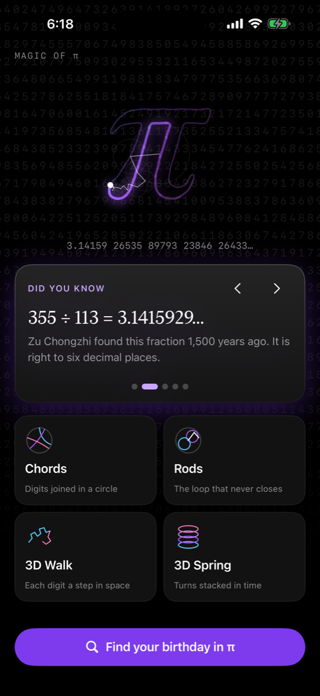
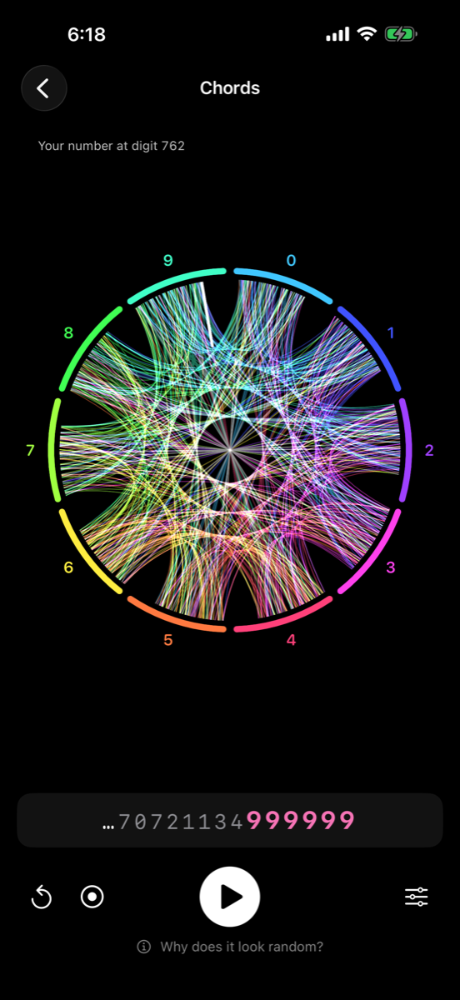
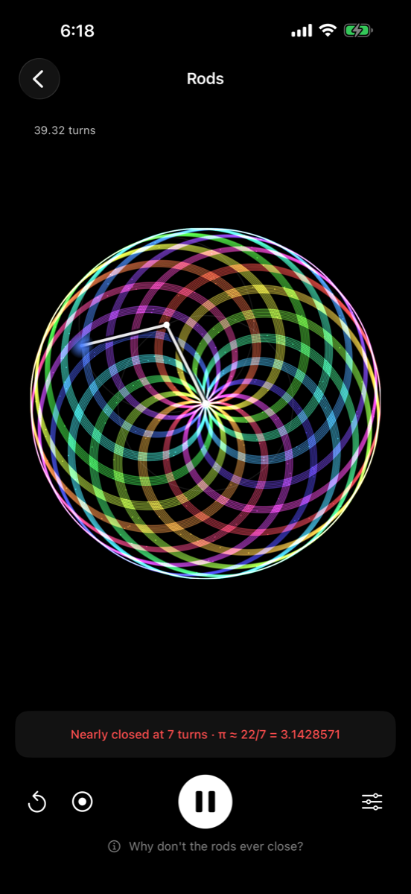
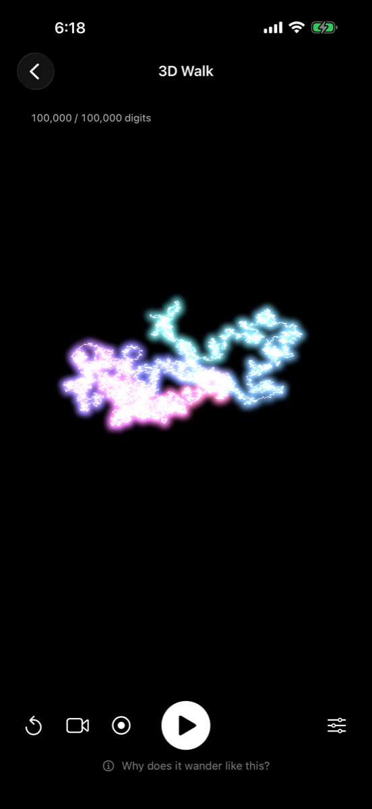
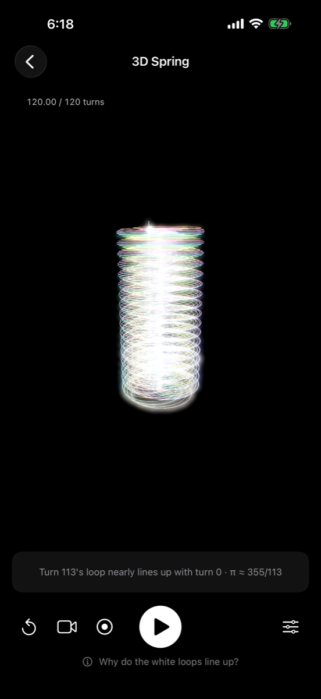

# Magic of π

An iPhone and iPad app that shows the magic of π: its endless, never-repeating digits and the
geometry of a number that is not a fraction. Watch a million digits draw a chord diagram, two
spinning rods that never quite close their loop, and π's digits walking through 3D space.

<p align="center">
  
  
  
  
  
</p>

## Features

**Visualizations**
- **Chords**: digits 0–9 around a ring; every pair of neighbouring digits in π draws a chord.
  Up to 1,000,000 digits, and the same for e, √2 and the golden ratio φ to compare.
- **Rods**: two rods, the second spinning π times faster. Because π is irrational the pen never
  returns to its start. *Spotlight* slows down and zooms (up to ×10,000,000,000) into the
  near-misses at 7, 106 and 113 turns, where π ≈ 22/7 and 355/113. Also: π's digits as rod
  speeds, a Fourier series of circles drawing the π glyph, and an editable formula.
- **3D Walk**: each digit is one step in its own direction (the 10 side vertices of an
  icosahedron), with a director camera and scripted camera moves.
- **3D Spring**: the rods' turns stacked over time; from above, the near-miss loops line up.

**Around them**
- **Find your birthday in π**: searches the first 10,000,000 digits, tries other ways of writing a
  date, and can show the result in Chords or the 3D Walk.
- **π music** (each digit a note of a pentatonic scale) and **haptics**.
- **Record a clip** of any visualization, **save a wallpaper**, and **view the 3D shapes in AR**.
- Short **"why?" explanations** for each visualization.

## Requirements

- Xcode 27 (the version it is built and tested with)
- iOS / iPadOS 17 or later
- AR needs a device with ARKit; recording and haptics need a real device

## Building

1. Open `PiVisualizer.xcodeproj` in Xcode.
2. Select the **PiVisualizer** target → *Signing & Capabilities* → choose your **Team**
   (a free Personal Team works for running on your own device).
3. If the bundle identifier is taken, change it to something unique, e.g. `com.yourname.MagicOfPi`.
4. Run on a simulator or device.

Run the unit tests with ⌘U, or:

```sh
xcodebuild test -project PiVisualizer.xcodeproj -scheme PiVisualizer \
  -destination 'platform=iOS Simulator,name=iPhone 17'
```

## How it works

| Area | Approach |
| --- | --- |
| Digits | Bundled, packed two per byte: 10,000,000 decimals of π (5 MB) and 1,000,000 each of e, √2 and φ |
| 2D drawing | SwiftUI `Canvas`, rendered on the GPU (`drawingGroup`) |
| Long runs | Older strokes are "baked" into a bitmap on a background queue (16-bit float for a million faint chords), so each frame only draws recent strokes |
| Deep zoom | Spotlight finds the true closest approach of each near-miss and draws the passes in double precision |
| 3D | SceneKit line geometry uploaded once; playback only changes how much is drawn. The camera eases with critically damped springs |
| Music | A small real-time synthesizer (`AVAudioSourceNode`), no audio files |
| Recording | ReplayKit in-app capture, cropped to the visualization and written with `AVAssetWriter` |

Source map:

```
PiVisualizer/
  PiVisualizerApp.swift, ContentView.swift   app entry, navigation
  HomeView.swift, SplashView.swift           home screen and opening animation
  ChordModeView.swift, PiChordModel.swift    Chords
  RodsModeView.swift, RodsModel.swift        Rods (incl. Spotlight and the formula editor)
  WalkModeView.swift, WalkModel.swift        3D Walk
  SpringModeView.swift, SpringModel.swift    3D Spring
  PiDigits.swift, PiOutline.swift            digits, search, the π glyph's Fourier series
  BakedLayer.swift, Motion.swift             background baking, camera smoothing
  PiMusic.swift, DigitHaptics.swift          sound and haptics
  VideoRecorder.swift, Wallpaper.swift       sharing
  ARExperience.swift                         AR
PiVisualizerTests/                           unit tests for the maths
tools/                                       scripts that compute, pack and draw the bundled data
```

## Reproducing the digits

The digit files are generated, not downloaded:

```sh
python3 tools/compute_pi.py pi.txt                 # Chudnovsky series, 10,000,000 decimals (~8 min)
python3 tools/compute_constants.py .               # e, √2, φ to 1,000,000 decimals (~1 min)
python3 tools/pack_digits.py pi.txt PiVisualizer/pi-digits.bin
```

The π digits were checked against two independent Machin-type formulas for the first 100,000
digits and against the published final digits of the first million; the unit tests check known
values such as the Feynman point (six 9s at decimal 762).

The app icon is drawn by `tools/make_icon.py`.

## Roadmap

See [ROADMAP.md](ROADMAP.md).

## Contributing

Issues and pull requests are welcome. Please run the unit tests before opening a pull request,
and keep new visualizations smooth on device at their largest setting.

## License

[MIT](LICENSE)
